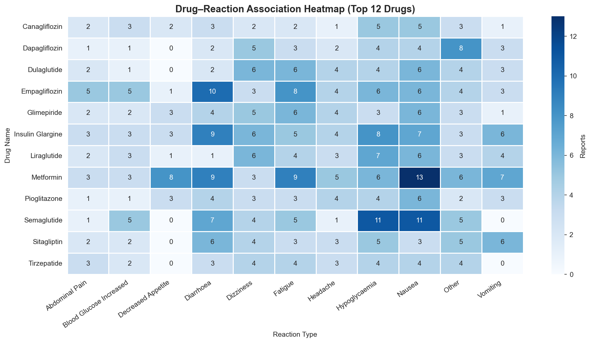

# FDA Diabetes Adverse-Event Data Analysis (EDA)

A modular Python data-cleaning and Exploratory Data Analysis (EDA) pipeline built to inspect FDA diabetes drug adverse-event reports, remove noisy records, and visualize drug–reaction and demographic patterns.

## Project Structure

```text
├── src/
│   ├── analysis.py               # Modular cleaning & chart-generation CLI pipeline
│   └── generate_sample_data.py   # Deterministic synthetic FDA-schema sample generator
├── data/
│   └── sample_fda_diabetes_data.csv  # Bundled synthetic demo dataset (FDA schema)
├── outputs/                      # Generated high-DPI EDA visualizations
├── tests/
│   └── test_analysis.py          # Automated unit tests for cleaning & chart export
└── requirements.txt
```

## Key Pipeline Steps

1. **Deduplication:** Detects and drops exact duplicate report entries.
2. **Demographic Standardization:** Normalizes mixed FDA sex codes (`1`/`2`, `unknown`, `0`) into `Male`, `Female`, and `Not Reported`, filtering incomplete entries cleanly.
3. **IQR Outlier Filtering:** Coerces `Patient_Age` to numeric and removes extreme statistical anomalies outside `[Q1 - 1.5*IQR, Q3 + 1.5*IQR]`.
4. **Temporal & Categorical Aggregation:** Parses `%Y%m%d` report dates into monthly series and consolidates long-tail reactions into the Top 10 + `Other`.
5. **Visual Analytics:** Generates 6 publication-ready PNG figures (reaction rankings, age histograms with mean/median markers, sex-stratified boxplots, monthly trends, drug–reaction heatmaps, and gender-normalized side-effect distributions).

## Preview Output



## Quick Start

```bash
pip install -r requirements.txt

# Run on the bundled synthetic FDA-schema sample dataset
python src/analysis.py

# Or run on your own local FDA CSV export
python src/analysis.py --data path/to/fda_drug_data.csv --output-dir outputs

# Execute automated verification tests
python -m unittest discover -s tests -v
```

> **Data Notice:** The repository bundles a deterministic synthetic CSV (`data/sample_fda_diabetes_data.csv`) matching the FDA adverse-event schema (`Date`, `Drug`, `Reaction`, `Patient_Age`, `Sex`) so reviewers can reproduce the entire pipeline without downloading large raw FDA exports.
